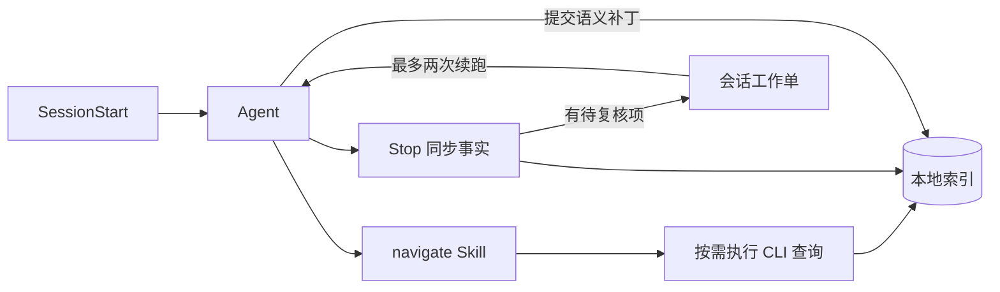

# M2 验收记录

本页是 v0.2 的历史记录。v0.3 已替换查询与 Stop 维护协议；当前结果见 [维护验收记录](index-maintenance-acceptance.md)。

日期 2026-11-15。基线为 M1 提交 `eaf1763`。正式验收需通过真实宿主续跑、Windows 打包和 Agent 对照门槛。

## 验证结果

| 项目 | 结果 |
|---|---|
| 工程检查 | Windows 11 x64、Node 24.15.0。从锁文件离线安装依赖，类型检查与构建通过。单元 25、集成 15、生命周期 6、Hook 20 和 stdio MCP 8，共 74 项通过。清单检查 49 项通过，源码清单另通过 Agent Plugins 1.0.0 schema 校验。 |
| 隔离安装 | Codex CLI `0.169.0-alpha.11.1`。验证 ZIP 的 SHA-256，从本地 marketplace 安装到包含中文和空格的路径。portable 清单能发现 Skill，但宿主跳过其 Hook。发行包由源清单生成独立的兼容清单。 |
| 真实宿主协议 | 在上述 Codex 中，信任前跳过两个 Hook，索引保持第 1 代。信任后，SessionStart 传入状态。Stop 同步事实并发出同会话续跑请求。模拟模型端点通过实际 CLI 应用夹具补丁，索引和语义版本均推进到 2。查询读到新语义，会话工作单清除。两次模型请求均无 Code Map 工具定义。 |
| 恢复与边界 | 重放覆盖外部编辑使批次失效、补丁缺项、跨会话工作单隔离、失效文件归属、重复 Stop 和两次续跑上限。全量用例覆盖重建事务、暂停和过期租约接管。 |
| 回退 | 校验旧 ZIP 后，从 v0.1 包运行 `doctor` 和 `sync`。两者均接受 M2 的 schema 1 索引，保留第 2 代与语义版本 2。源码哈希一致。 |
| 真实 Agent 对照 | 缺少实际模型处理的 20 组成对任务记录及初建 Token。统计器已用合成记录验证。桌面菜单初建和实际模型生成语义补丁仍待验收。 |

本机默认 `node` 为 24.3.0。测试在进程环境中使用 24.15.0。安装后，Codex 的 PATH 需要提供 Node 24.15.0 或更高版本。

## 索引性能

夹具 A 有 1,000 个文件、10 MiB 源码和 21,003 个索引节点。`npm run bench:index -- A 20` 预热 3 轮，测量 20 轮。复测通过实施方案的 7 项门槛。392 次 stdio 请求全部成功，清单过期的每批并发请求共享一次完整复核。

| 指标 | 复测 | 门槛 |
|---|---:|---:|
| 冷首建 | 27.71 s | ≤ 30 s |
| 无变化检查 P95 | 299 ms | ≤ 1 s |
| 单文件增量 P95 | 1.95 s | ≤ 3 s |
| stdio 热路径单项 P95 | 18 ms | ≤ 500 ms |
| stdio 热路径 8 并发混合批量 P95 | 376 ms | ≤ 1 s |
| stdio 清单过期时 8 并发 P95 | 424 ms | ≤ 2 s |
| 索引进程峰值 RSS | 687 MiB | ≤ 1,536 MiB |

默认 CLI 的 207 次查询全部成功。每次启动独立进程，单项 P95 为 760 ms，8 并发混合批量 P95 为 1.81 s。前两次冷首建分别为 35.39 s 和 33.88 s。第二次单文件增量 P95 为 6.80 s，CLI 单项与 8 并发 P95 分别为 1.42 s 和 2.79 s。复测前将初建与维护模块改为按命令加载。耗时存在运行间波动。夹具 B 待测。

## 查询与维护入口

默认包注册两个 Skill 与两个 Hook。四项查询共用现有协议及索引。CLI 用 `--root` 指定工作区，其他参数通过 UTF-8 JSON 输入。源码中的 stdio MCP 用于独立运行和回归测试。

`doctor` 与查询报告已记录的维护结果。当前的 Hook 信任状态在 Codex 中查看。Hook 不可用时，运行 `sync`，再用 `annotate --prepare` 和 `--apply` 复核语义。

## Agent 对照输入

在相同 Codex 模型及设置下交错运行 20 个配对任务。缺陷定位 8 个，小功能修改 6 个，调用影响 6 个。每对恢复到相同源码快照，各运行使用新会话。按预先确认的答案和测试判定成功与错误定位。

每次运行保存一个 JSON 文件，记录这些字段。

| 字段 | 含义 |
|---|---|
| `task_id`、`kind`、`group` | 同一任务 ID。类型为 `defect`、`feature` 或 `impact`。分组为 `control` 或 `codemap`。 |
| `model`、`settings_id`、`snapshot_id`、`session_id` | 同模型和设置、同对使用同一个快照、每次使用唯一会话。 |
| `success`、`wrong_locations` | 按人工答案和测试评分。 |
| `input_tokens`、`output_tokens`、`maintenance_tokens` | 输入与输出统计整次任务。维护 Token 是两者之和的子集。 |
| `source_bytes_read`、`map_query_bytes`、`maintenance_failures`、`duration_ms` | 源码读取量、查询输出量、维护失败次数、端到端耗时。 |

另存 `bootstrap.json`，记录首次完整建图用量 `bootstrap_tokens`。运行 `npm run bench:agent -- <目录>`。退出码 0 表示达到门槛，1 表示结果未达标，2 表示记录不完整或无效。夹具和事件重放只用于工程验证。
